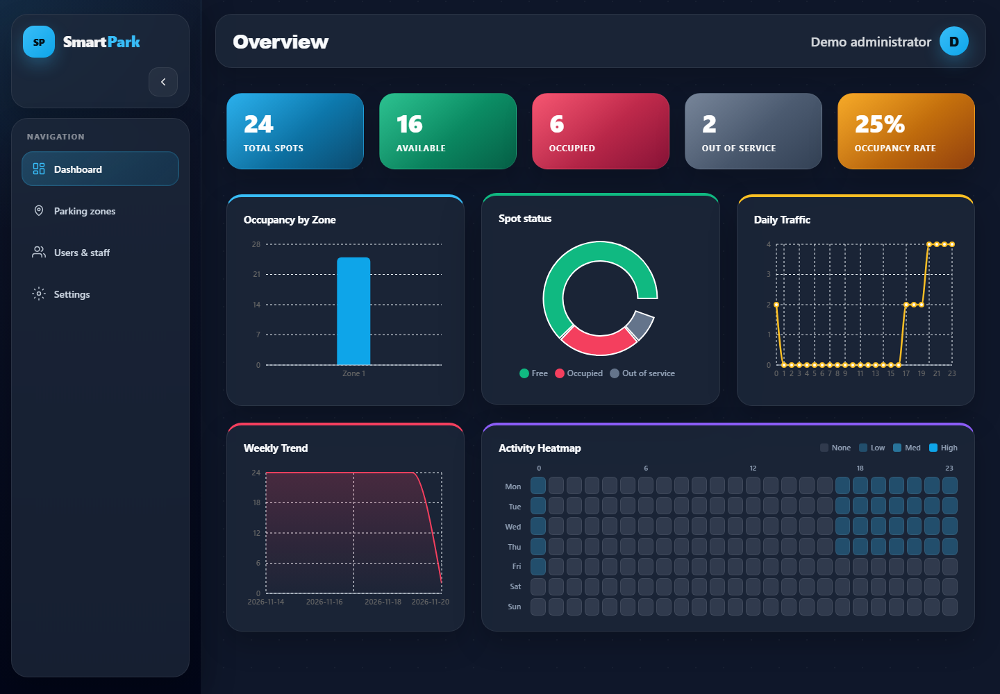
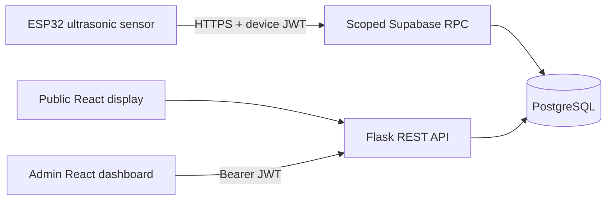

# Smart Park

[](https://github.com/Omar-Ayadi-5/Smart-Park-public/actions/workflows/ci.yml)

A full-stack parking monitoring prototype connecting an ESP32 ultrasonic sensor, a Flask API, and two React applications. Visitors see available spaces; administrators monitor traffic, approve staff accounts, and manage out-of-service spots.



[Watch the recorded walkthrough](docs/images/walkthrough.webm) ? [Public display](docs/images/public-display.png) ? [Parking controls](docs/images/parking-controls.png)

All screenshots and the recording use a disposable database with synthetic data. No live account or deployment credentials are included.

## What the project demonstrates

- **Frontend:** separate public and admin React/Vite apps, shared Axios client, responsive parking layout, and Recharts analytics.
- **Backend:** Flask application factory, SQLAlchemy models, role-based authorization, current-account JWT validation, bounded input, and rate-limited authentication.
- **Data:** Alembic migrations, repeatable development seeds, an audit trail for parking changes, and a transactionally scoped PostgreSQL sensor function.
- **Hardware:** ESP32 hysteresis and stable-state detection, authenticated Supabase updates, CA-verified TLS, and reconnect/retry behavior.
- **Verification:** API regression tests, real browser flows, dependency audits, and CI jobs for both web apps, PostgreSQL, and firmware compilation.

## Architecture and decisions



The two interfaces share an API layer without sharing their navigation or login flow. The API reads account approval and role from the database on every authenticated request, so deleted or demoted accounts cannot retain old permissions through a signed token. Device identity is mapped server-side to a single spot; firmware cannot select arbitrary spot IDs. Maintenance flags take precedence over sensor observations.

SQLite supports a self-contained web demo and fast tests. PostgreSQL provides the production schema and sensor RPC. Analytics currently aggregate seven days of activity in application memory with a fixed UTC+1 presentation offset; larger deployments would need database-side aggregation and configurable time zones.

## Quick start: web demo

Requires Python 3.10+ and Node.js 22.12+. Run these commands in PowerShell from a fresh checkout:

```powershell
cd backend
python -m venv .venv
.venv\Scripts\Activate.ps1
python -m pip install -r requirements.txt
Copy-Item .env.example .env
```

Edit `backend/.env`. For the local web demo use `DATABASE_URL=sqlite:///smartpark.db`. Generate a fresh signing key with `python -c "import secrets; print(secrets.token_hex(32))"` and set `SECRET_KEY` to the result. The example placeholder is intentionally rejected at startup.

```shell
python -m flask --app app:create_app db upgrade
python -m flask --app app:create_app seed-demo
python -m flask --app app:create_app create-admin
python run.py
```

`create-admin` prompts for your own email, username, and password. There is no shared/default admin account. `seed-demo` adds 24 synthetic spots only when the database has no parking data and is safe to rerun.

In separate terminals, from the repository root:

```powershell
Copy-Item frontend/admin/src/.env.example frontend/admin/src/.env
npm --prefix frontend/admin run setup
npm --prefix frontend/admin run dev
```

```powershell
Copy-Item frontend/public/src/.env.example frontend/public/src/.env
npm --prefix frontend/public run setup
npm --prefix frontend/public run dev
```

Open the admin app at **http://localhost:5173** and the public display at **http://localhost:5174**. The API runs on port 5000. On macOS/Linux use `source .venv/bin/activate` and `cp` instead of the PowerShell equivalents.

## Repository map

| Path | Purpose |
| --- | --- |
| `backend/app/` | API, models, authorization, and setup commands |
| `backend/migrations/` | Versioned schema and sensor-function migrations |
| `backend/database/sensor_rpc.sql` | Restricted, transactional device update function |
| `backend/tests/` | Authentication, authorization, parking, and PostgreSQL tests |
| `backend/iot_config` | Canonical ESP32 firmware source |
| `backend/firmware/smart_park/` | Arduino sketch entry point |
| `frontend/admin/src/` | Admin React/Vite application |
| `frontend/public/src/` | Public React/Vite application |
| `frontend/shared/` | Shared API client and loading state |
| `tools/capture_demo.py` | Reproducible browser checks and portfolio recording |

[Backend and API setup](backend/README.md) ? [Frontend setup and hosting](frontend/README.md) ? [Hardware setup](backend/IOT.md) ? [Security](SECURITY.md) ? [Contributing](CONTRIBUTING.md)

## Checks

```shell
python -m pip install -r backend/requirements-dev.txt
python -m pytest -q backend/tests
npm --prefix frontend/admin run lint
npm --prefix frontend/public run lint
npm --prefix frontend/admin run build
npm --prefix frontend/public run build
```

The API tests run on isolated SQLite by default. Set `TEST_DATABASE_URL` to a **disposable** PostgreSQL database to include sensor RPC integration; tests create and drop tables. CI supplies this database automatically. To run the full browser workflow after installing both frontends:

```shell
python -m playwright install chromium
python tools/capture_demo.py
```

Add `--capture` to regenerate the screenshots and recording. The tool starts local servers, creates its own temporary database and random credentials, and cleans them up afterward.

## Scope and limits

This is a portfolio prototype, not a production parking deployment. Hardware requires an ESP32 and separately provisioned Supabase Auth device identities. Multi-worker authentication rate limiting needs a shared Redis backend. Browser tokens are currently stored in localStorage, so XSS prevention remains important; logout removes the local token, while account revocation is checked server-side. See the security and hardware guides for deployment details.
